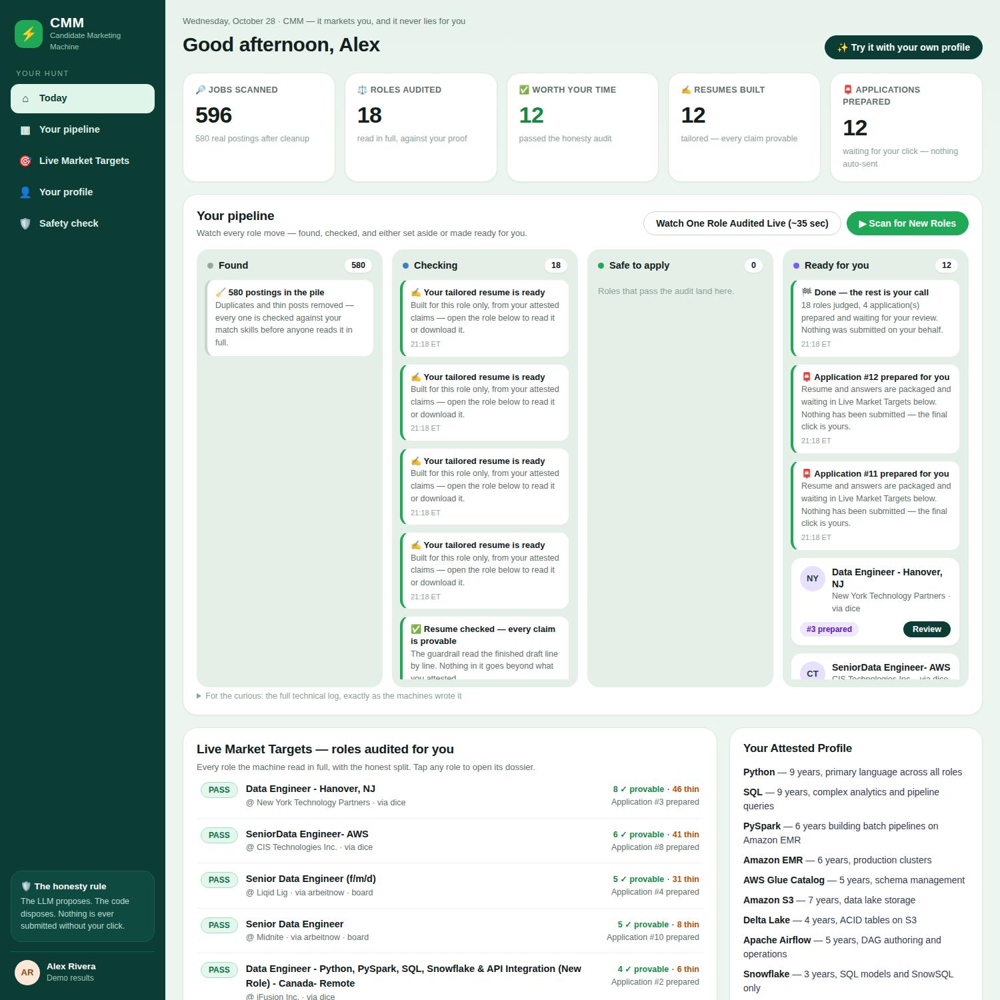
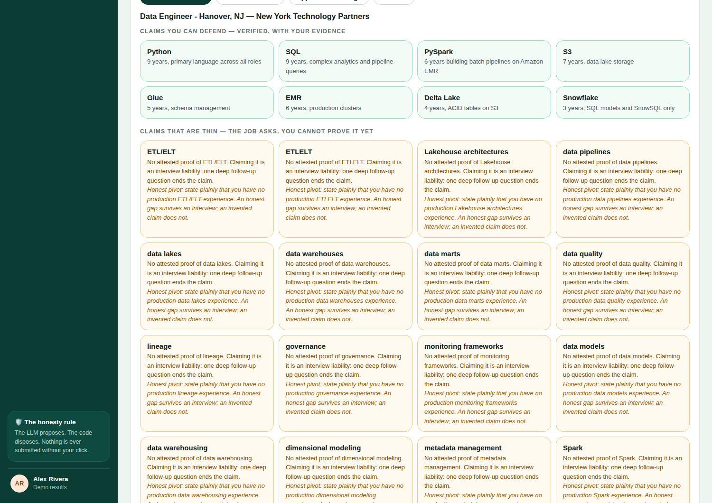

# CMM — Candidate Marketing Machine

**CMM works for the job seeker — it markets you, and it never lies for you.**

The zero-hallucination career agent with deterministic guardrails.

> The LLM proposes. The code disposes.

## For judges

- **Live demo:** https://madkidcopilot.duckdns.org/judge/ — type any name to
  enter; no password and no API key needed. Connect is one click, and Reset
  restores the demo to its starting state.
- **Demo video (2:47):** https://www.youtube.com/watch?v=pEAoNMtz1E0
- **Track:** Startup — Problem statement 1, "Build for Your World"
  (Meta Global AI Developer Hackathon, Oct 26 – Nov 4, 2026).
- **Zero dependencies:** the whole product is stdlib-only Python 3 — clone
  it and it runs.

## What CMM does

AI resume tools invent skills, beat the ATS, and get the job seeker
destroyed in the technical interview. CMM is the antidote: a multi-agent
system where Meta's Muse Spark agents do the reading and the drafting,
and a deterministic Python verifier — never an LLM — decides what the
seeker may truthfully claim.

You attest your skills once, with evidence and hard boundaries ("never
used Snowpark"). CMM hunts real postings on Dice and LinkedIn, reads each
one in full, and cross-checks every requirement against your proof. What
survives becomes an **Evidence Dossier** — the claims you can defend, the
claims that are thin (each with an honest pivot), never a match score —
and a tailored resume built only from what you can defend.

And it finishes the job: when you click **Apply** on a role that passed,
CMM's Applier goes and submits the application for you, in your own
signed-in session, and brings back the employer's confirmation. Nothing
is ever submitted without your click.



*Mission Control: every role found, audited against your proof, and
either set aside or made ready for you — nothing moves without your
click.*



*The Evidence Dossier for one role: claims you can defend (green, each
with its evidence) and claims that are thin (amber, each with an honest
pivot). A separate Safety Check strikes what you never attested —
Kafka, Snowpark, Terraform, an invented 40% — before anything is built.*

## How it works

```
FORM ──► sweep config ──► SWEEPER ──► PARSER ──► keep rule
     ──► READER (Muse Spark) ──► VERIFIER (deterministic) ──► matches
     ──► BUILDER (Muse Spark) ──► tailored resumes ──► APPLIER ──► outcomes
```

| Stage | Powered by | Where it runs |
|---|---|---|
| Sweeper — Dice | Plain code | Inside the product |
| Sweeper — LinkedIn (the Scout) | **Muse Wonder agent** in the seeker's own signed-in session | The seeker's browser |
| Parser · Keep rule · **Verifier** | Plain code — never an LLM | Inside the product |
| Reader · Builder | **Muse Spark 1.3** (Meta Model API) | Called by the product |
| Applier — packaging & outcome tracking | Plain code | Inside the product |
| Applier — the submission itself | **Muse Wonder agent** on the seeker's own signed-in session, on the seeker's click | The seeker's browser |
| The final decision | **The human** | — |

Two moments in a job search can only happen *as the member*: LinkedIn's
contract-filtered, hours-fresh search exists only inside a signed-in
session, and a Dice application can only be submitted by the signed-in
seeker. An API key cannot be a member. So those two seats are worked by
Muse Wonder agents in the seeker's own session — read-only while
scouting, acting only on an explicit Apply click while applying — and
CMM never asks for or stores a password or a cookie.

The guardrail is the product: Muse Spark proposes, deterministic code
disposes. Any unattested term or invented metric in a draft triggers a
REJECT and a rewrite, in the open — and the same check runs on the
seeker's own outgoing resume at intake, before any agent runs.

## Run it

Stdlib-only Python 3. No dependencies, no `pip install`.

```bash
export META_MODEL_API_KEY=<your Meta Model API key>

# Mission Control web UI:
python3 run_web.py 8765          # http://127.0.0.1:8765

# Complete flow from the demo form (form -> sweep -> verdict -> dossiers):
python3 run_flow.py demo/form_alex.json examples_out/flow

# Single-JD fixture mode:
python3 run_demo.py --jd demo/jd_snowpark.md --profile demo/profile_attested.md --out examples_out

# Tests (no API key needed):
python3 -m unittest discover -s tests -v
```

## Models

Reader + Builder run on `muse-spark-1.3` via the Meta Model API
(`https://api.meta.ai/v1/chat/completions`, OpenAI-compatible). Muse
Spark spends completion tokens on hidden reasoning first, so calls use
generous `max_tokens` and the reasoning counts are surfaced in the live
event stream — latency reads as computation, not a stall. Everything
else in the pipeline is deterministic Python; no other model is used
anywhere.

## Built during the hackathon

Everything in this repository — the code, the tests, the Mission Control
web UI, and the Muse Spark integration — was written from scratch during
the Meta Global AI Developer Hackathon, Oct 26 – Nov 4, 2026. CMM grows
out of the founder's production job-search system; that system
contributed operational lessons only. No code, data, or candidate
information from it is in this repository.

## Licence

© 2026 Sharyaz Hafeez Mohammed — all rights reserved. Public for Meta hackathon judging only; see `LICENSE`. No reuse, copying, or commercial use without written permission.
